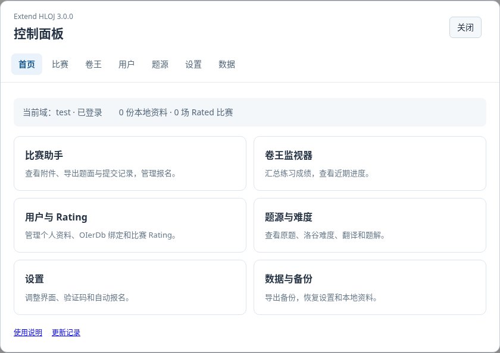

# Extend HLOJ

为 HLOJ / Hydro 提供题源与难度、作业补题计划、比赛工具、练习统计、个人资料和 Rating 的浏览器脚本。当前版本 **3.1.0**。

**[安装 / 更新脚本](https://raw.githubusercontent.com/sxmqwq/new-exhloj/main/dist/exhloj.user.js)** · **[下载与更新说明](https://github.com/sxmqwq/new-exhloj/releases/latest)** · [使用指南](docs/INSTALL.zh-CN.txt)



## 开始使用

1. 安装 [Tampermonkey](https://www.tampermonkey.net/)。
2. 点击上方的 **安装 / 更新脚本**，按浏览器提示完成安装。
3. 刷新 OJ，在用户名菜单中点击 **Extend HLOJ**。也可以从浏览器的油猴菜单选择 **Extend HLOJ**。

所有工具集中在同一个面板中。升级现有脚本会沿用设置和本地资料，也可以在 **数据** 页面导出备份。

## 可以做什么

| 面板 | 功能 |
| --- | --- |
| 比赛 | 下载作业和比赛附件；导出题面、提交记录和 Ghost；检查报名、配置自动报名 |
| 卷王 | 汇总公开练习成绩，查看近期进度与快照变化 |
| 用户 | 管理本地资料、OIerDb 绑定、姓名显示和比赛 Rating |
| 题源 | 按题意搜索候选原题，查看原题链接、洛谷难度、翻译与题解 |
| 设置 | 界面增强、验证码识别、编辑器连接和模块开关 |
| 数据 | 备份与恢复设置、题源配置、用户资料和 Rating |

题目名称中的 `[QOJ18209]` 等标记可以自动识别为 QOJ 题源；洛谷难度按新版体系显示，包含青色“提高”。题源和已知难度紧跟时间、内存标签，点击题号可直达原站。标题右侧的 **题目工具** 收纳复制、发送、搜索和配置，展开时不移动题面。CPH 与 CP Editor 可在 **题目工具 → 编辑器设置** 中分别开关。[查看题目页菜单示例](docs/images/title-menu.png)

## 常用操作

**作业补题计划**：在域的作业首页打开 **作业工具 → 补题计划**。选起止日期，填每道题最少需要几人通过，再开始查找。例如填 5，会列出至少有一份区间内作业的榜单已有 5 人通过、自己在本域还没通过的题。时间按作业开始日期筛选，含首尾两天。重复题目合并，保留对应作业，人数不跨作业相加。

打开工具不会自动请求。再次筛选会复用当前账号和域最近 10 分钟的读取结果；刚交了题、想看最新榜单时，可先在面板里重置缓存再查。上次完整计划可在下次打开时查看，读取失败或无权限会标明。

**调整域排名表**：在 **Extend HLOJ → 排名页** 分别开启统计信息左对齐、隐藏个人简介。两项默认关闭，比赛和作业成绩表保留各自布局。

**查看用户信息**：进入用户主页，点头像旁的 **用户信息**。面板内可查看本地资料、Rating、OIerDb 和获奖记录，展开 **拥有权限** 可查看该用户的当前域权限。入口本身也可在 **设置 → 菜单精简 → 用户主页** 单独关闭。

**精简菜单**：用户名菜单或油猴菜单 → Extend HLOJ → 设置 → 菜单精简。题目侧栏的零讨论、零题解，以及顶栏的题库、训练、讨论、评测记录默认隐藏，可逐项恢复。作业和比赛的代码查重都只在明确有权限时显示。若想保留权限未知的入口，在 **作业与比赛侧栏** 分别勾选「权限未知时显示作业查重」或「权限未知时显示比赛查重」并保存。明确无权限的入口仍隐藏。

**下载附件**：在作业详情或成绩表打开 **作业工具 → 作业助手**；比赛详情或榜单打开 **比赛工具 → 比赛助手**。在「附件」中点击文件名即可下载。

**按题意找原题**：题目工具 → 按题意搜索原题（未识别题源时也可直接点 **查找原题**），或面板 → 题源 → 按题意搜索原题。编辑题面或简述，选择[原题机](https://yuantiji.ac/)和 / 或 [CPRet](https://cpret.online/)，点击开始搜索。两站的结果分别展示，支持展开同组候选；打开原题核对题意、限制和样例，点击 **核对并关联 → 确认并保存题源**。搜索和选择候选都不会自动覆盖已有题源。

搜索只在点击后发送输入框内容，不发送 OJ 账号或 Cookie。长题面建议先简述；CPRet 受查询长度和 2048 token 限制，原题机接受至多 16000 字符。单站失败不影响另一站，也可复制题意后打开检索网站。候选只在本次页面内缓存，确认的题源保存在本地；相似度不能代替人工判断，也不能跨网站比较。

**自动报名**：面板 → 比赛 → 自动报名设置。填写目标（例如 `pnoi/contest`），按需设置标题筛选，启用后保存。运行时保持 OJ 登录并开着一个 OJ 页面。

**OIerDb 导入**：面板 → 用户 → 编辑资料，粘贴选手主页链接。快捷导入可以从域排名页生成候选，由你确认后保存；已绑定资料可单人或批量刷新。

**比赛 Rating**：在比赛详情或榜单页打开 **比赛工具 → 加入 Rating 并结算**。普通结算接着已保存的分数计算，重复比赛自动跳过。**时间轴结算**可选择日期和比赛，从 1800 重新计算所选历史。[计算规则](docs/RATING.zh-CN.md)

用户资料、Rating 和设置保存在当前浏览器。读取榜单、原题和题解时使用当前账号可访问的数据。

## 下载

[最新发布页](https://github.com/sxmqwq/new-exhloj/releases/latest)提供安装脚本和离线安装包；一般直接安装 `.user.js` 即可。仓库的 `release/` 只保留当前版本安装包，历史改动见 [更新记录](CHANGELOG.md)。

## 开发

需要 Node.js 24 和 Python 3。源码位于 `src/`，安装脚本位于 `dist/`。

```bash
npm ci
npm run build
npm run check
```

构建、测试与目录说明见 [开发文档](docs/DEVELOPMENT.md)。遇到问题可提交 [Issue](https://github.com/sxmqwq/new-exhloj/issues)。

原版作者署名及参考来源见 [NOTICE.md](NOTICE.md)，第三方许可证见 [THIRD_PARTY_NOTICES.txt](THIRD_PARTY_NOTICES.txt)。
